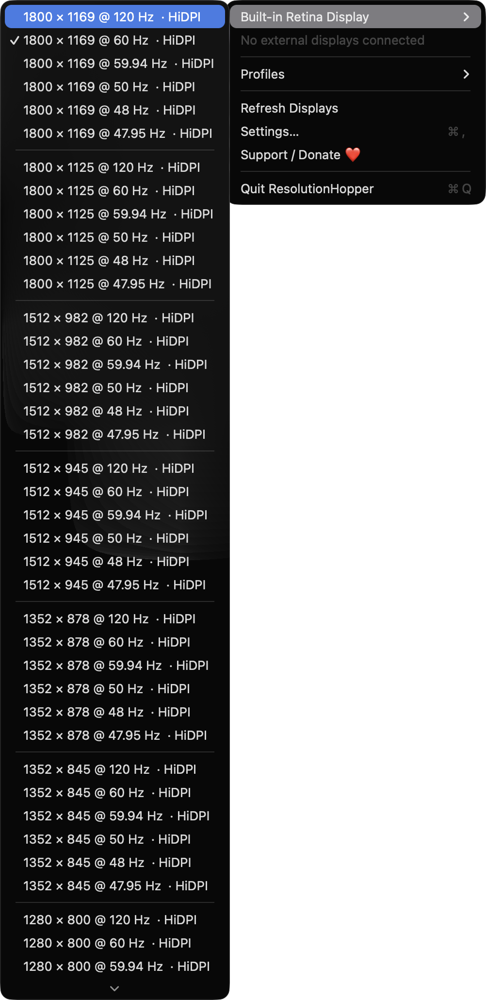
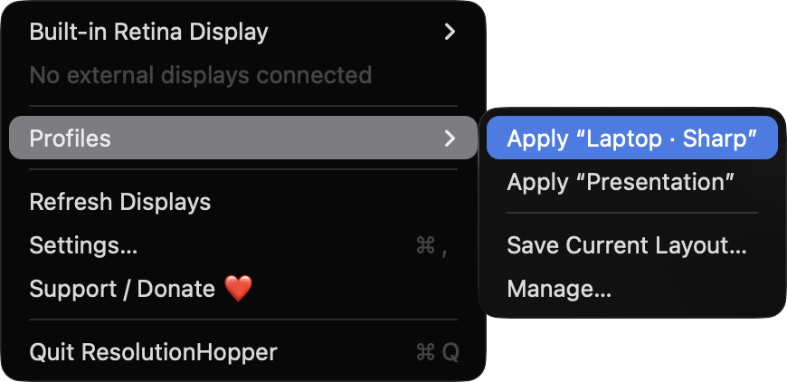
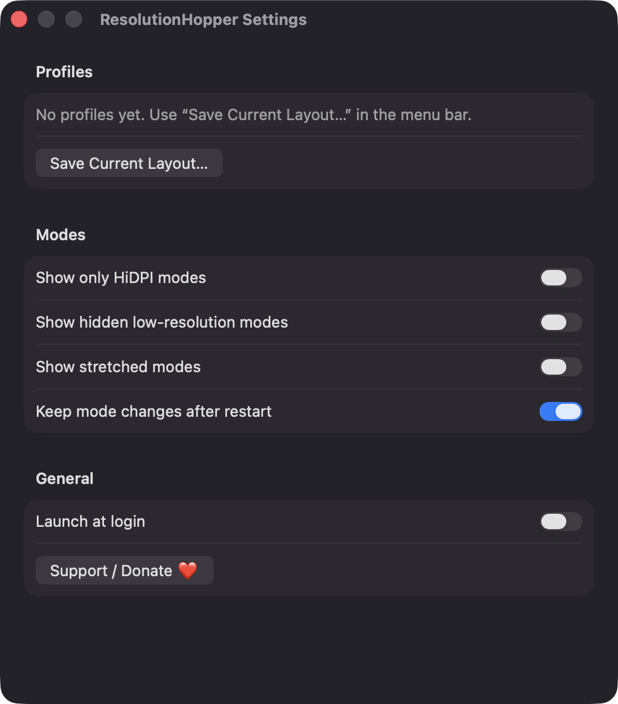
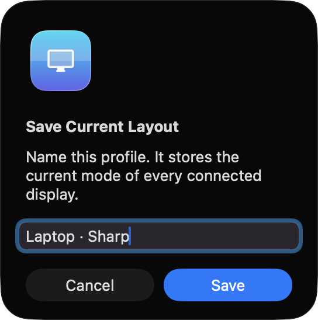

# ResolutionHopper

**🌐 Website:** [turhe123.github.io/resolution-hopper](https://turhe123.github.io/resolution-hopper/)

Switch any display to a saved resolution and refresh rate from the menu bar, or let a profile do it for you.


## Why

ResolutionHopper is a free, open-source, 100% native, backend-free alternative to paid utilities in the *Display & Brightness* category. It was inspired by SwitchResX ($16 one-time), which has long been a go-to for people with external monitors, projectors and capture cards who need quick resolution changes that System Settings buries. ResolutionHopper covers a smaller feature set: switching modes and saving layouts as profiles.

## Features

- **Menu bar app** (no Dock icon) listing every connected display, each with a submenu of all available display modes.
- **Modes grouped by resolution** and sorted by refresh rate, with HiDPI and stretched modes labelled. The current mode has a checkmark.
- **Mode filters**: show only HiDPI modes, show hidden low-resolution duplicates, show stretched modes. Modes not usable for the desktop are always hidden.
- **Profiles**: save the current mode of all displays as a named profile and apply it from the menu with one click.
- **Global hotkeys** per profile, recorded in Settings (registered with Carbon `RegisterEventHotKey`).
- **Automatic rules**: apply a profile when a chosen external display connects.
- **15-second Keep / Revert countdown** after each switch. It runs on a main run loop timer, so it still fires if the screen goes black.
- **Reliable display identity**: displays are matched across reconnects by vendor, model and serial number, not display ID.
- **Mirror sets**: modes are applied to the primary display of a mirror set.
- **Safe failures**: profile entries for displays that aren't connected are skipped and reported in the menu. If CoreGraphics rejects a change, an alert shows the error code and the previous state is kept.
- **Persistence option**: choose whether mode changes survive a restart or last only for the session.
- **Launch at login** via `SMAppService`.
- Profiles are stored as JSON in `~/Library/Application Support/ResolutionHopper/profiles.json`.
- A visible **Support / Donate ❤️** button in the menu and in Settings.

## Screenshots

<p align="center"></p>

<p align="center"><em>The menu bar menu with the Built-in Retina Display submenu open, listing HiDPI modes grouped by resolution and sorted by refresh rate, with a checkmark on the current mode.</em></p>

<p align="center"></p>

<p align="center"><em>The Profiles submenu applies a saved layout in one click, or saves the current one as a new profile.</em></p>

<p align="center"></p>

<p align="center"><em>Settings for profiles, mode filters, keeping changes after restart, launch at login, and the Support button.</em></p>

<p align="center"></p>

<p align="center"><em>Saving the current display layout as a named profile.</em></p>

## Install

1. Download `ResolutionHopper-macOS.zip` from https://github.com/turhe123/resolution-hopper/releases/latest.
2. Unzip it and move `ResolutionHopper.app` to `/Applications`.
3. Because the app is open source and not notarized, run:

   ```bash
   xattr -cr /Applications/ResolutionHopper.app
   ```

4. Right-click the app and choose **Open** the first time.

## Build from source

Requires macOS 14+ and Xcode with Swift 5.9+.

```bash
brew install xcodegen
xcodegen generate
xcodebuild -project ResolutionHopper.xcodeproj -scheme ResolutionHopper -configuration Release -derivedDataPath ./build build
```

The app is produced at `build/Build/Products/Release/ResolutionHopper.app`.

## Permissions

Going by the source, ResolutionHopper doesn't trigger any macOS privacy prompts:

- **Accessibility**: not requested. Global hotkeys use Carbon `RegisterEventHotKey`, which needs no permission.
- **Screen Recording**: not requested. The app only reads display modes and sets them through CoreGraphics.
- **Microphone, Camera, Location, Contacts**: not requested or used.
- **Login Items**: only if you turn on "Launch at login" in Settings. The app registers itself with `SMAppService`, and macOS may list it under System Settings › General › Login Items.
- **Network**: none. There are no network calls except opening the Ko-fi page in your browser when you click Support.

## Built with AI

ResolutionHopper was written by [Claude Code](https://claude.com/claude-code) inside an automated pipeline, from a plain-English spec. No code, binaries or assets from any commercial app were used; it is a clean-room reimplementation of a feature set, not a copy.

What that means in practice:

- The full source is in this repo under the MIT license. Read it before you run it.
- No network calls, no analytics, no third-party dependencies. Only Apple frameworks.
- Ad-hoc signed and not notarized, which is why Gatekeeper warns on first launch.
- It has had less human review than a hand-written app. Bug reports and pull requests are welcome.

## Support ❤️

If ResolutionHopper is useful to you, you can support its development:

[Support Or (Leo) Davidai ❤️ on Ko-fi](https://ko-fi.com/leodavidai)

## License

MIT © Or Davidai Bachar

## More free Mac apps

Prefer something that runs in the browser? The same pipeline builds [free, private web tools](https://turhe123.github.io/web-tools/): PDF, image, developer, data and audio tools, nothing uploaded.
